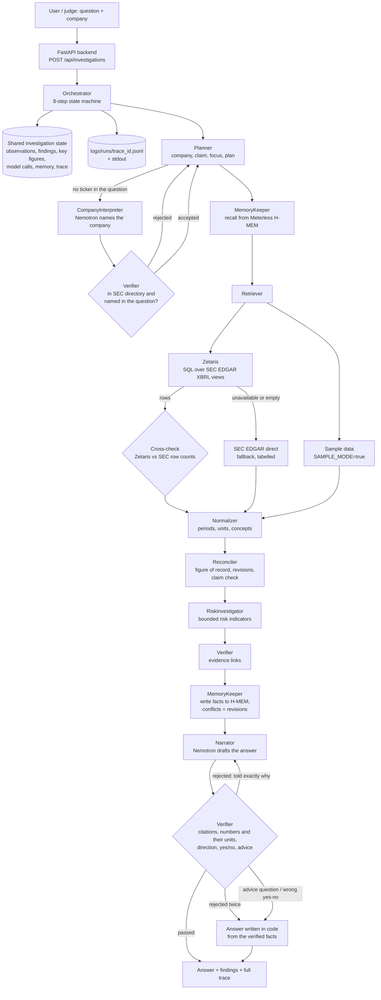

# Parallax

**Understand the facts. Investigate the risks. Explore the possibilities.**

Parallax is an AI research agent that answers questions about any US-listed company **from its official SEC filings**, and shows where every number came from. Ask *"Is Tesla's revenue still growing?"* or paste a post claiming *"Apple made $500 billion last year"*, and Parallax checks the filings, explains what it found in plain words, and shows every step it took.

Financial information is everywhere, but much of it is wrong: a quarterly figure quoted as the full year, a number that was later revised, or an AI answer with no source. Parallax treats every number as something to verify, not something to trust.

It is an educational tool. It does not rate securities, predict prices or give investment advice.

Open Agent Hackathon 2026. Primary track: **Track 1, Solving Fragmented Intelligence**. Also relevant to Track 2, *The Agent That Can Explain Why*.

> **Sponsor technology:** Zetaris (data layer) · Meterless H-MEM (memory engine) · Meterless Nightshift (AI provider) · NVIDIA Nemotron 3.5 Lightning 30B (through Nightshift)
> **Run:** `./scripts/dev.sh`, then open http://127.0.0.1:5174 · **API:** `curl -X POST http://127.0.0.1:8000/run -H "Content-Type: application/json" -d @input_examples/example_1.json`
> **Sponsor technology explanation:** [`docs/SPONSOR_TECHNOLOGY.md`](docs/SPONSOR_TECHNOLOGY.md)

---

## Try it in two minutes (sample mode, nothing connected)

Requirements: Python 3.11+ and Node 20+.

```bash
./scripts/dev.sh
```

Open **http://127.0.0.1:5174**, set the data selector at the top to **Sample (offline)**, then:

1. **Investigate** → click **Northwind Motors (SAMPLE, fictional)** → click *"Is Northwind Motors' free cash flow positive?"*
2. Try the sample case *"Was Northwind Motors' 2024 revenue really $13.6 billion?"*. Parallax shows the $13.6B is one quarter; the full year was $52.4B.
3. Open **Overview → Investigation progress** and **Sources** to see every step, query and memory behind the answer.

Sample mode needs no internet, keys, Zetaris or AI. It uses two **fictional** companies, Northwind Motors and Contoso Retail, labeled `SAMPLE DATA` everywhere. Without an AI model, every answer is computed by Parallax from the filings and labeled so.

`dev.sh` creates `.env` from `.env.example`, sets up `backend/.venv`, vendors the Meterless H-MEM engine, and starts the backend (:8000), the H-MEM memory service (:8765) and the app (:5174).

Or with Docker: `cp .env.example .env && docker compose up --build`, then open http://localhost:8080.

To force sample mode whatever else is configured, set `SAMPLE_MODE=true` in `.env`.

## How the agent works

Parallax is one agent made of specialised roles that share one investigation state. Two roles call **NVIDIA Nemotron through Meterless Nightshift**; the rest are code, so every number is computed and every decision is repeatable. The **Verifier** has authority over the model: it can send a draft back, override it, or replace it.



| Role | Responsibility | Uses | Can block, retry or fall back? |
|---|---|---|---|
| Planner | Reads the question: company, claim, focus figure, steps | code | Stops the run if no company is found |
| CompanyInterpreter | Names the company when the question has no ticker ("JP Morgan" → JPM) | Nemotron via Nightshift | Its answer is checked by the Verifier |
| MemoryKeeper | Recalls earlier figures; stores every figure with its source; reports conflicts | Meterless H-MEM | A conflict becomes a "revised figure" finding |
| Retriever | Queries the filings through Zetaris; cross-checks row counts with the SEC | Zetaris, SEC EDGAR | Falls back to SEC EDGAR directly if Zetaris fails |
| Normalizer | Classifies periods (year, quarter, year-to-date), units, concepts | code | Flags stale data |
| Reconciler | Picks the figure of record, finds revisions, checks claims | code | Marks claims contradicted or unverifiable |
| RiskInvestigator | Runs a bounded set of risk indicators | code | |
| Narrator | Explains the findings in plain words; voices the Pre-Mortem | Nemotron via Nightshift | Retries once when the Verifier rejects it |
| Verifier | Checks evidence links and every AI output | code | **Rejects, overrides or replaces** model output |
| Orchestrator | Runs the steps, saves the state, returns the result | code | Reports `NEEDS_MORE_EVIDENCE` or `FAILED` honestly |

**Collaboration in practice:** the Verifier sends a rejected draft back to the Narrator with the reason (critique loop); a second failure falls back to a code-written answer (role authority); Zetaris failures fall back to the SEC (escalation); H-MEM conflicts from earlier runs change the findings of this one (shared memory); and every role reads and writes the same investigation state.

## Agent trace

Every investigation writes one JSON line per decision to `logs/runs/<trace_id>.jsonl`, prints the same events to stdout, and returns them from `GET /api/investigations/{id}/trace`. From [example 5](logs/examples/example_5_trace.jsonl), where Nemotron worked out a ratio itself and the Verifier would not accept it:

```json
{"agent_name":"Planner","action":"plan","output_summary":"Steps: retrieve, normalize, reconcile, investigate risks, verify; focus long_term_debt","target_agent":"MemoryKeeper","retry_count":0,"status":"success"}
{"agent_name":"MemoryKeeper","action":"recall","output_summary":"8 prior memories recalled from Meterless H-MEM","target_agent":"Retriever","retry_count":0,"status":"success"}
{"agent_name":"Retriever","action":"load_sample","output_summary":"58 observations from the fictional sample filings","target_agent":"Normalizer","retry_count":0,"status":"success"}
{"agent_name":"RiskInvestigator","action":"run_indicators","output_summary":"3 flagged: Profit rose +22.2% while operating cash flow fell -30.8% in 2024 (3 years running); Long-term debt $19.50B, +62.5% since 2021; …","target_agent":"Verifier","retry_count":0,"status":"success"}
{"agent_name":"Narrator","action":"draft_answer","output_summary":"Draft citing 14 findings and 19 facts","target_agent":"Verifier","retry_count":0,"status":"success","model":"nvidia/nemotron-3.5-lightning-30b-a3b"}
{"agent_name":"Verifier","action":"validate_answer","output_summary":"Rejected: numbers not in the evidence in that form (worked out by the model?): ['5.4 as a multiple']","target_agent":"Narrator","retry_count":0,"status":"needs_revision"}
{"agent_name":"Narrator","action":"draft_answer","output_summary":"Draft citing 14 findings and 19 facts","target_agent":"Verifier","retry_count":1,"status":"success","model":"nvidia/nemotron-3.5-lightning-30b-a3b"}
{"agent_name":"Verifier","action":"validate_answer","output_summary":"Rejected: numbers not in the evidence in that form (worked out by the model?): ['5.4 as a multiple']","target_agent":"Orchestrator","retry_count":1,"status":"rejected"}
{"agent_name":"Verifier","action":"fallback_to_code","output_summary":"Showing the answer written in code from the verified findings","target_agent":"Orchestrator","retry_count":1,"status":"fallback"}
{"agent_name":"Orchestrator","action":"finish","output_summary":"Answer (computed in code): Cash and equivalents was $3.60B in FY2024, down 25.0% … Long-term debt was $19.50B in FY2024, up 16.1% …","status":"completed"}
```

(Abridged: every line also carries `timestamp`, `trace_id`, `input_summary` and, for model calls, `duration_ms`.) The app shows the same run under **Overview → Investigation progress** and **Sources → Integration trail**, including each Zetaris SQL query with its request ID, rows and timing, and each model call with the model named in Nightshift's reply and its token usage.

## Sample inputs and outputs

Six real runs, recorded on 2026-10-27 with Zetaris, H-MEM and Nightshift (Nemotron) running. Inputs are in [`input_examples/`](input_examples), the saved outputs in [`output_examples/`](output_examples) and their traces in [`logs/examples/`](logs/examples). Run any of them yourself against a running app:

```bash
curl -X POST http://127.0.0.1:8000/run -H "Content-Type: application/json" -d @input_examples/example_1.json
python3 scripts/run_example.py input_examples/example_1.json     # same call, prints the trace step by step
```

`POST /run` runs the whole investigation and returns structured JSON: the answer and who wrote it, findings, key figures, model calls (with the model that handled each), data requests per source, memory activity, limitations and the full agent trace. A malformed request gets HTTP 422 with the reason.

| # | Question | Data | Answer (abridged) | What it shows |
|---|---|---|---|---|
| 1 | Was Northwind Motors' 2024 revenue really $13.6 billion? | sample | "No, the $13.6 billion figure refers only to a single quarter (July–September 2024), not the full year." | Claim check: quarter quoted as the year |
| 2 | Should I buy Northwind Motors stock? | sample | "Parallax doesn't make investment decisions for you. The findings below show what the filings say…" | Verifier overrides: no advice |
| 3 | Is Microsoft's free cash flow positive? | Zetaris | "Yes, Microsoft's free cash flow was $66.99B in FY2026." | 18 Zetaris SQL queries, 3,393 rows, SEC cross-check passed |
| 4 | Tell me about the finances and the growth of JP Morgan in 2025 (no ticker) | Zetaris | "JP Morgan's 2025 revenue grew 2.8% to $182.45B, but net income fell 2.4% to $57.05B…" | Company found from the name; bank's negative operating cash flow flagged |
| 5 | How many times bigger is Northwind Motors' debt than its cash? | sample | Code-written: "Cash … $3.60B in FY2024 … Long-term debt was $19.50B in FY2024…" | Verifier rejects a ratio the model calculated, twice; falls back to code |
| 6 | Has Northwind Motors revised any of its figures? (after *Publish fictional amended filing*) | sample | "Yes … Revenue for FY2024 was first reported as $52.40B and later revised to $51.90B…" | H-MEM detects 2 conflicts with earlier memory |

Examples 1, 2, 5 and 6 need nothing but the app; with Nightshift off their answers are written in code and labelled so. Examples 3 and 4 need Zetaris (or set `data_mode` to `sec_direct` and an `SEC_USER_AGENT`).

## What you can do

| Section | What it does |
|---|---|
| **Home** | The latest investigation's key figures and chart, recent investigations, your watchlist, a calendar and real events (new filings, revised figures, tripwire hits). |
| **Investigate** | Search a company (one letter is enough), pick it, and ask your own question, or tap a suggested one. The answer cites the filings; tabs show Financials (with a **Key figures** table), Risks, Sources, Stress-test and Notes & tripwires. |
| **Check a post** | Paste a post or article. Parallax finds each financial claim, checks it against the filings and explains any mix-up (wrong year, quarter vs year, units, an old figure). |
| **Savings & fees** | Compare a savings account, a low-fee fund and a high-fee fund, with money lost to fees and inflation shown. All assumptions are editable and labeled hypothetical. |
| **Compare** | Compare 2–3 companies on their filings **with the names hidden**, so a famous brand can't sway you. Choose which to look into, then reveal. |
| **Pre-Mortem** | *"Imagine this went badly. What most likely went wrong?"* A Skeptic and a Defender argue only from the verified findings, followed by questions only you can answer. |
| **Decision Diary** | Record your decision in your own words with **tripwires** (e.g. "free cash flow falls below $0"). Every watchlist check re-tests them with code. |
| **Watchlist** | Follow companies. Each check compares fresh filings with what Parallax remembers and shows exactly what changed. In sample mode, *Publish fictional amended filing* demonstrates a detected revision; *Reset the sample demo* lets you show it again. |
| **Data Sources** | Live status of Zetaris, Meterless H-MEM, Meterless Nightshift and SEC EDGAR. |

Financial terms are underlined throughout: hover or tap one for a plain-English definition.

## How answers stay trustworthy

1. **Filings first.** Figures come from SEC EDGAR XBRL filings, through Zetaris or directly. The figure of record is the latest financial-statement filing; earlier filed values are kept, so revisions are visible.
2. **Code does the maths.** A facts sheet is computed for every investigation: 11 filed figures (revenue, gross profit, operating income, net income, operating cash flow, capital spending, R&D, cash, long-term debt, buybacks, dividends) and 8 derived ones (gross, operating, net and free-cash-flow margins, free cash flow, R&D share of revenue, cash minus debt, buybacks plus dividends). A figure the company stopped reporting years ago is labeled "no current figure" rather than shown as current.
3. **The AI is checked, not trusted.** Before an AI answer is shown, Parallax checks that it cites real findings, uses only numbers from the evidence, agrees with the direction of every change (rose or fell), matches any yes/no the filings settle, and contains no advice. A rejected answer gets one retry told exactly what to fix; if that fails, Parallax writes the answer in code from the facts, or says plainly that it has no checked answer.
4. **No advice.** "Should I buy…?" always gets a fixed reply, followed by what the filings show.
5. **Nothing is hidden.** Results appear only after verification. Every step, SQL query, SEC request, AI call (with the model that handled it and its token usage) and memory read or write is shown in the app.

Investigation steps: `RECEIVED → PLANNING → RETRIEVING → NORMALIZING → RECONCILING → INVESTIGATING_RISKS → VERIFYING → COMPLETED`.

## Failure handling

| Failure | What Parallax does |
|---|---|
| Zetaris unreachable or returns no rows | Retrieves the same figures from SEC EDGAR directly, and says so in the answer's limitations and the trace (`fallback_sec_direct`) |
| Zetaris and SEC row counts disagree | Records a cross-check finding with both counts; the trace shows `mismatch` |
| SEC EDGAR unreachable (15 s timeout) | Finishes as `NEEDS_MORE_EVIDENCE` with the reason, instead of guessing |
| H-MEM unreachable | Continues without memory and lists it as a limitation |
| Nightshift not running, or a model call fails | The answer is written in code from the verified facts and labelled "No model used" |
| Nemotron rejects the reasoning switch (HTTP 400) | Retries the call once without it |
| A draft fails verification | One retry told exactly what to fix; then a code-written answer, or "no checked answer" rather than a guess |
| The model names a company that isn't in the question | Rejected; Parallax asks the user to pick the company |
| No company found | `NEEDS_MORE_EVIDENCE`, with how to name the company (any SEC-listed ticker works) |
| A figure the company stopped reporting | Shown as "last reported FY…; no current figure", never as current |
| Malformed request | HTTP 422 with the validation error |
| Any other error | The run ends as `FAILED` with the error shown and traced; nothing is invented |

## Limitations

- US-listed companies only, from their SEC XBRL figures; the text of filings (risk factors, management discussion) is not read yet.
- Meterless Nightshift's free edition runs on Macs with Apple silicon. Without it, everything works and answers are written in code.
- Some indicators read differently for banks and insurers (for example negative operating cash flow); Parallax adds a note when that applies.
- English questions only. Single user, run locally; no accounts.
- An educational tool: figures are as filed, not audited by Parallax, and nothing is investment advice.

## Sponsor technology

The submission's sponsor technology explanation: [`docs/SPONSOR_TECHNOLOGY.md`](docs/SPONSOR_TECHNOLOGY.md). Details of each integration, and what has been verified live: [`docs/INTEGRATIONS.md`](docs/INTEGRATIONS.md).

**Zetaris: the data layer** ([`backend/app/integrations/zetaris/`](backend/app/integrations/zetaris))
- SEC EDGAR XBRL concepts are registered in Zetaris as `CREATE LIGHTNING REST TABLE` sources with `CREATE SCHEMASTORE VIEW`s, and Parallax reads them with SQL through Zetaris's `run-query` API.
- Every view is kept only if Zetaris's row count matches the SEC's; 143 views across 13 companies are verified so far, and the count grows as new companies are looked up. A new company is registered on first lookup, and figures added later get their own views.
- Every query is recorded with its SQL, request ID, rows and timing, and shown in the Integration trail.

**Meterless: H-MEM memory engine** ([`services/hmem-sidecar/`](services/hmem-sidecar), [`backend/app/integrations/meterless/`](backend/app/integrations/meterless))
- The official H-MEM reference engine stores every figure Parallax finds, with provenance, and re-confirms it on later checks.
- A changed figure is recorded as a conflict in H-MEM's append-only trust ledger, which powers the Watchlist's revision detection, the Decision Diary and the audit trail (click any memory ID).
- **Test result** (`cd services/hmem-sidecar && npm test`, against the real engine, 2026-10-27):

  ```text
  ok 1 - health names the engine source
  ok 2 - new fact, re-confirmation, then a conflicting later filing
  ok 3 - a fact without a source is rejected
  ok 4 - recall is isolated per company
  # tests 4
  # pass 4
  # fail 0
  ```
- To see it working in the app: in sample mode, follow Northwind Motors on the **Watchlist**, click *Publish fictional amended filing*, then *Check now*. H-MEM records the conflict and the Watchlist shows exactly which figure changed.

**Meterless Nightshift: the AI provider, routing to NVIDIA Nemotron** ([`backend/app/integrations/meterless/runtime.py`](backend/app/integrations/meterless/runtime.py))
- Every AI call goes to Nightshift, found automatically on this Mac (port 8088, with the app's own token). Nightshift routes it to **NVIDIA Nemotron 3.5 Lightning 30B** (`nvidia/nemotron-3.5-lightning-30b-a3b`), with Nemotron's reasoning switched off for fast, structured answers.
- The model that handled each request, as named in Nightshift's reply, is shown on every answer ("Written by nvidia/nemotron-… via Meterless Nightshift"), in the Pre-Mortem and in the Integration trail.
- Setup: install Nightshift (free Mac M1+ edition: https://www.meterless.ai/mac.html) and add NVIDIA as a provider in the app. If Nightshift isn't running, answers are written in code.

**NVIDIA's contribution:** Nemotron writes the plain-English explanation of every investigation, the Pre-Mortem's Skeptic and Defender, and recognises which company a question is about ("JP Morgan" → JPM). Parallax's checks then decide whether its output is shown.

### What was unique about our use of the sponsor technologies

- **Zetaris as a verified data layer, not a pass-through.** Parallax registers SEC filings in Zetaris on demand and keeps a view only when Zetaris's row count matches the SEC's, so the data layer is checked before any figure is used.
- **H-MEM as the agent's memory of what the filings said.** Instead of chat history, H-MEM holds every filed figure with its source. Its append-only conflict ledger is what turns "the company revised its numbers" into a visible event, which powers revision detection, tripwires and the audit trail.
- **Nightshift and Nemotron under supervision.** Nemotron explains the findings, but never decides them: every number, direction (rose or fell) and yes/no it writes is checked against the facts, and a failed answer gets one targeted retry, then a code-written answer. The model that handled each request is shown on the answer.
- **Built for people checking numbers, not trading on them.** All three technologies serve one goal: showing where every number came from, and catching the common mix-ups (quarter vs year, revised figures, wrong units) in posts and AI answers.

## Configuration

`.env.example` lists every setting. The main ones:

| Setting | Purpose |
|---|---|
| `FINSIGHT_DATA_MODE` | `zetaris` (default), `sec_direct` or `sample`. The data selector in the app overrides it per investigation. If Zetaris isn't reachable, Parallax uses SEC directly and labels it. |
| `SAMPLE_MODE` | `true` forces sample mode (fictional data, nothing connected), whatever `FINSIGHT_DATA_MODE` says. |
| `SEC_USER_AGENT` | Required for live data: `"app-name you@example.com"` (the SEC asks for a contact). |
| `ZETARIS_*` | Your Zetaris instance and login. `ZETARIS_AUTO_REGISTER=false` turns off registration on first lookup. |
| `METERLESS_MODEL` | The model Nightshift should use; default `nvidia/nemotron-3.5-lightning-30b-a3b`. |
| `LLM_PROVIDER` | `auto` (use Nightshift when it is running) or `none` (answers always written in code). |
| `PARALLAX_LOG_DIR` | Where agent traces are written (default `logs/`, as `logs/runs/<trace_id>.jsonl`); empty = stdout only. |

Some setting names keep the project's original `FINSIGHT_` prefix so existing setups keep working.

To register companies in Zetaris ahead of time:

```bash
backend/.venv/bin/python scripts/zetaris_setup.py --dry-run          # show the SQL; sends nothing
backend/.venv/bin/python scripts/zetaris_setup.py --apply            # create the sources, then verify them
```

## Tests

```bash
cd backend && .venv/bin/pytest -q              # 136 tests: reconciliation, risks, key figures, answers and checks, claims, company recognition, agent trace, watchlist, Zetaris, Meterless, API
cd services/hmem-sidecar && npm test           # 4 tests against the real H-MEM engine
cd frontend-v2 && npm test                     # 14 unit tests
cd frontend-v2 && npm run test:e2e             # 16 browser tests of real user flows (first time: npx playwright install chromium)
cd frontend-v2 && npm run build                # type check + production build
```

The browser tests start their own private backend, memory service and app in sample mode, with no AI and a temporary database, so they never touch your `.env`, data or memory and need no internet. GitHub Actions ([`.github/workflows/ci.yml`](.github/workflows/ci.yml)) runs all of the above, plus a Docker build, on every push.

## API

| Method | Path | Purpose |
|---|---|---|
| POST | `/run` | run one investigation and return its structured result and trace in one call |
| GET | `/health` | service health |
| GET | `/api/integrations/status?deep=true` | live status of Zetaris, H-MEM and Meterless Nightshift |
| GET | `/api/companies`, `/api/companies/search?q=` | built-in and sample companies; search any SEC-listed company |
| POST, GET | `/api/investigations`, `/api/investigations/{id}` | start an investigation `{question, ticker?, data_mode?}`; read its steps, findings, figures and trail |
| GET | `/api/investigations/{id}/trace` | the agent trace: one entry per decision |
| POST | `/api/investigations/{id}/premortem` | Pre-Mortem voices and questions |
| POST | `/api/claims/check` | check every claim in pasted text |
| POST | `/api/scenarios/calculate` | savings and fees scenarios |
| GET | `/api/glossary`, `/api/memory/{id}/audit` | plain-English glossary; H-MEM ledger history of one memory |
| GET, POST, DELETE | `/api/watchlist`, `/api/watchlist/{ticker}`, `/api/watchlist/check` | follow, list, unfollow and re-check companies |
| GET, POST | `/api/decisions`, `/api/decisions/{id}/check`, `/api/tripwire-metrics` | decision diary and tripwires |
| POST | `/api/board`, `/api/board/{id}/reveal` | brand-blind comparison |
| GET, POST, DELETE | `/api/sample/amendment` | publish or reset the fictional Northwind amended filing |

## Repository layout

```
backend/app/            FastAPI app
  agents/               investigation workflow, AI narrator, watchlist, charts
  analysis/             key figures (the facts sheet)
  financial_data/       SEC client, company directory, providers (Zetaris, SEC, sample)
  integrations/         Zetaris and Meterless (H-MEM client, Nightshift runtime)
  reconciliation/       figure of record, revisions, claim checks
  risk_analysis/        risk indicators
  verification/         checks on AI output (numbers, direction, yes/no, advice)
  tracing.py            agent trace (logs/runs/<trace_id>.jsonl + stdout)
  decisions/            decision diary, tripwires, brand-blind board, pre-mortem
  explain/, scenarios/, models/, api/
backend/tests/          pytest suite
services/hmem-sidecar/  HTTP wrapper around the Meterless H-MEM reference engine
frontend-v2/            the app: React, TypeScript, Vite, Tailwind, Apache ECharts (+ e2e/ browser tests)
zetaris/                generated Lightning SQL and the verified-view manifest
sample_data/            fictional sample companies (labeled SAMPLE)
scripts/                dev.sh, zetaris_setup.py, run_example.py
input_examples/         six example requests
output_examples/        their saved outputs (real runs)
logs/examples/          their agent traces
docker/, docker-compose.yml, .github/workflows/
```

## Pre-existing components

- **Meterless H-MEM reference engine**, open source, fetched unmodified into `services/hmem-sidecar/vendor/hmem` by `dev.sh`; Parallax's sidecar wraps it in an HTTP service.
- **Open-source libraries** listed in `backend/pyproject.toml`, `frontend-v2/package.json` and `services/hmem-sidecar/package.json`.
- **Data:** SEC EDGAR filings are public and fetched at run time. The Zetaris view manifest and the fictional sample companies were made during the build window.

All Parallax code was written during the build window (first commit 25 October 2026).
